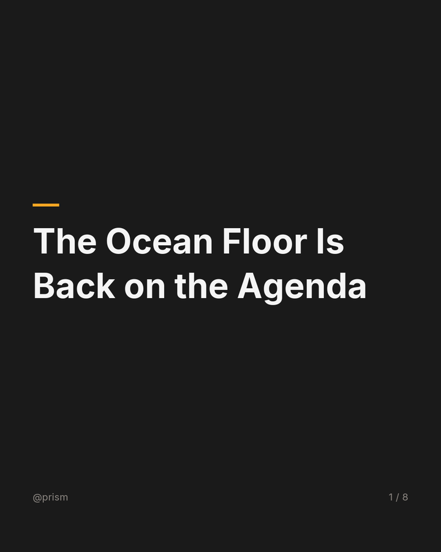
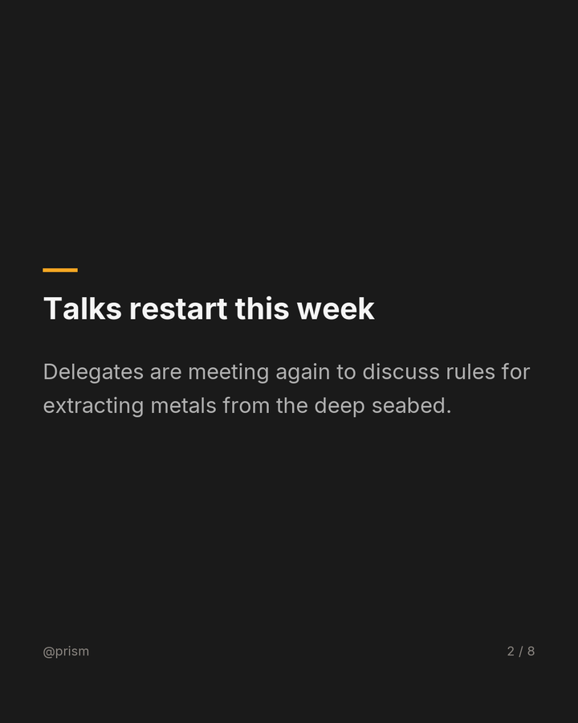

# Prism

*A human-in-the-loop content automation framework.*

Prism turns one trending topic into Instagram-ready carousel decks, then puts
every deck in a human review queue before anything leaves the machine.

## Prerequisites

- Python 3.11+
- Node 20+

No Docker, no ffmpeg, no audio/video tooling.

## Quick start

```bash
cp .env.example .env     # set LLM_KEY, or leave empty for the FakeLLM demo
make setup
make dev                 # http://localhost:5173
```

API docs: http://localhost:8000/docs

## What it is

Prism discovers topics from pluggable sources, generates angle options, and
runs one of three carousel plugins through a shared pipeline: spec → ingest (news) →
render → export → metadata → policy → validate → publish. Each artifact carries an
immutable provenance manifest and lands in a review queue where you edit
metadata and approve or reject it.

## What it looks like

<p align="center">
  
  
  
</p>

One generated `news_carousel` deck (1080×1350 each), from `make demo`: a cover,
a sourced news point, and the attribution slide. Regenerate them any time with
`make demo` and look in `review/<job_id>/slides/`.

## Architecture

React + Vite → FastAPI (:8000) → SQLite (WAL) ← worker process → plugin pipeline
→ Pillow renderer → zip. Three local processes, no containers.

## Plugins

| Plugin | Slide structure | Output |
|---|---|---|
| `facts_carousel` | cover + facts + CTA | 1080×1350 PNG sequence + zip |
| `news_carousel` | cover + news points + sources + CTA | 1080×1350 PNG sequence + zip |
| `faq_carousel` | cover + Q&A + CTA | 1080×1350 PNG sequence + zip |

## Adapters

| Interface | Default | Fallbacks |
|---|---|---|
| LLM | `openai_compat` (any OpenAI-compatible provider) | `fake` |
| Card renderer | `templated` (Pillow + Inter) | — |
| Export | `zip` | — |
| Trend sources | Google News RSS, Hacker News, Reddit, Trends CSV, manual | soft-fail per source |
| News sources | `google_news_rss` | `fake` when `FAKE_ADAPTERS=1` |

The LLM adapter takes any OpenAI-compatible `base_url` + `model`; `LLM_KEY` is the
provider key. Provider-specific request fields can go in `extra_body`.

## Tuning

Scoring weights and the safety threshold in `config.yaml` are defaults, not
facts. Tune them after roughly 20 real runs; the doc marks every knob with
`⚠️ TUNE`.

## Failure paths

Failures surface as typed errors in `manifest.error` and on the job page; no
job fails silently.

| Symptom | Error / response | What you see, what to do |
|---|---|---|
| `LLM_KEY` missing, or the provider is down | `fake` LLM takes over and the job is marked `degraded` (no error); `AdapterUnavailable` only if the whole chain is empty | Amber "degraded" badge on Review; set `LLM_KEY` for real output. |
| Candidate fails the safety filter | `unsafe_candidate` (HTTP 400) on manual entry; auto-discovered candidates are dropped | Nothing is queued; rephrase the topic or title. |
| Spec breaks the plugin schema | one re-prompt, then `SpecValidationError` | Job FAILED at `spec`; retry the job. |
| News run finds fewer articles than `min_sources` | `InsufficientSourcesError(found, required)` | Job FAILED at `ingest`; a failing adapter is recorded in `manifest.ingest_errors` — widen the topic or adjust `min_sources`. |
| Topic matches `block_topics` | `PolicyViolation` | Job FAILED at `policy`; remove the blocked phrase. |
| Card renderer exhausts retries on a slide | `SlideRenderError` | Job FAILED at `render`; the failing slide index is in the error context. |
| Text does not fit a slide's safe area | `SlideOverflowError` | Job FAILED at `render`; shorten the offending field. |
| Artifact fails checks (size, alt text, caption, slide count) | `ValidationError` with reasons | Job FAILED at `validate`; each reason is listed in the manifest. |
| Worker dies mid-job | job FAILED with `WorkerLost` once the heartbeat is stale (~15 s) | Restart `make worker`, then re-run the job; runs are not resumed. |
| Trends CSV upload over 5 MB | HTTP 413 `file_too_large` | Trim the CSV and upload again. |

Metadata generation is the one soft failure: if the LLM call fails, captions and
alt text fall back to derived values and the job still succeeds. `ConfigError`
flags a broken setup (invalid `config.yaml`, missing style or font), and
`RetryExhausted` is the retry helper's exhausted-attempts error. Every error
serializes to `{error_class, stage, message, retryable, context}`.

## Demo

`make demo` runs all three plugins with the deterministic fakes — no key, no
network — and writes one artifact per plugin to `review/<job_id>/`. The decks
then sit in the review queue.

## Testing

```bash
make test
```

CI uses `FAKE_ADAPTERS=1` and requires no API keys.

## Scope and non-goals

In: discovery, angles, three carousel plugins, review queue, provenance.
Out: auth, cloud deploy, Docker, auto-publishing, video, audio, rich media.

## License

MIT — see [LICENSE](LICENSE).
